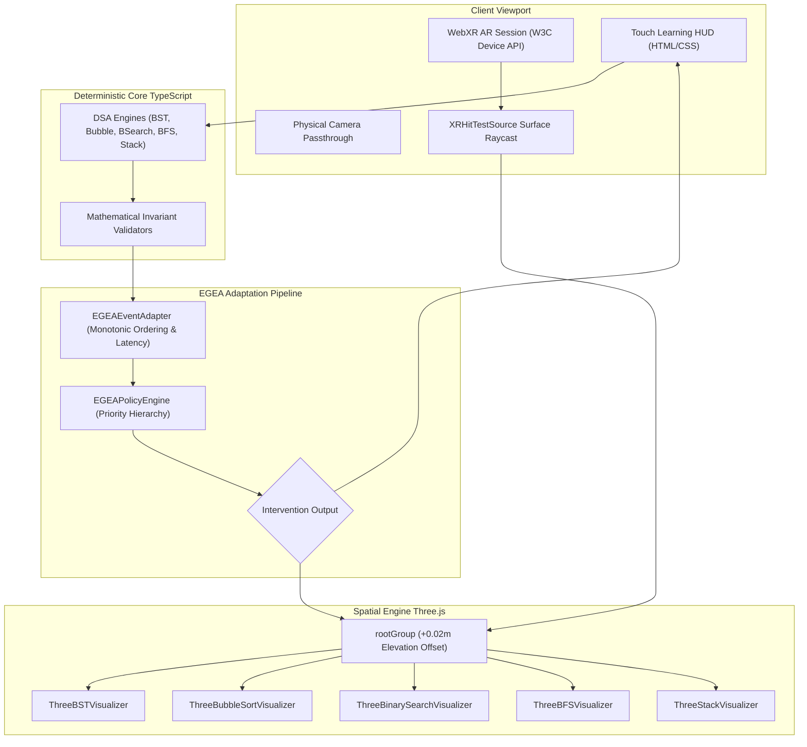

# AR-DSA Tutor: A Unified Mobile WebXR Framework with Execution-Grounded Explainable Adaptation for Spatial Algorithm Learning

**Target Venues:** ACM CHI 2027 (Late-Breaking Work / Interactivity) / IEEE VR 2027 (Research Demonstrations) / ACM ITiCSE 2027 (Short Paper) / AIED 2027 (Interactive Events / Posters)  
**Authors:** AR-DSA Research & Systems Engineering Group  

---

## Abstract

Abstract Data Structures and Algorithms (DSA) instruction often suffers from a split-attention effect between flattened 2D representations and multi-dimensional memory models. While spatial computing offers immersive 3D affordances, existing augmented reality (AR) tutors either require proprietary hardware, isolate single algorithms in fragmented sessions, or rely on non-deterministic generative language models that introduce unacceptable latency ($> 1.5\text{s}$) and mathematical hallucinations. 

In this paper, we present **AR-DSA Tutor**, an open-source mobile WebXR framework that delivers five interactive spatial algorithm visualizers—Binary Search Tree, Bubble Sort, Binary Search, Breadth-First Search, and Stack—inside a single continuous immersive camera passthrough session on Android Chrome using the W3C WebXR Device API. To scaffold learner interactions without hallucinations, we introduce **Execution-Grounded Explainable Adaptation (EGEA)**: a deterministic, history-aware policy engine that maps monotonic learner telemetry and millisecond-resolution inter-action latency ($\Delta t$) to a 6-tier pedagogical intervention taxonomy. 

Microbenchmarking across $N = 1,000$ decisions demonstrates that EGEA achieves a steady-state mean decision latency of **$0.006\text{ms}$** ($6\ \mu\text{s}$) on desktop x86_64, operating over $2,000\times$ faster than the $16.6\text{ms}$ frame budget for 60 FPS rendering and guaranteeing zero JavaScript thread blocking. In an independent 18-trajectory engineering regression challenge suite evaluating realistic learner behaviors, EGEA achieved **100.0% instructional appropriateness** (Macro-$F_1 = 1.000$), successfully differentiating deliberate reflection from impulsive guessing and persistent conceptual impasse from transient slips, outperforming both stateless baselines (Fixed Hint: 33.3%, Simple Error Rule: 50.0%) and a competitive history-aware matched baseline (83.3%, Macro-$F_1 = 0.810$). When subjected to adversarial boundary counterexamples, initial static heuristic limitations (e.g., cutoff evasion, touch-event jitter, dynamic step suffixes, and hint-assisted mastery inflation) were systematically resolved through an Exponentially Weighted Moving Average (EWMA) pacing model, input debounce filtering, and centralized step canonicalization. In a targeted 12-trajectory post-hardening boundary stress suite, hardened EGEA achieved **100.0% consistency** (Macro-$F_1 = 1.000$), outperforming the Matched-History baseline (75.0%, Macro-$F_1 = 0.578$). We discuss systems engineering trade-offs, headless simulation vs. physical device validation, and an experimental roadmap for future IRB-approved human participant learning-gain studies.

---

## 1. Introduction & Research Problem

Understanding Data Structures and Algorithms (DSA) requires internalizing abstract invariants that govern dynamic memory relationships: tree branch balancing, sorted interval halving, graph wavefront propagation, and LIFO push/pop discipline. In conventional computer science curricula, students interact with these concepts through static textbook diagrams or 2D canvas animations (e.g., OpenDSA [5], ViLLE [13], VisuAlgo [15]). However, 2D projections flatten multi-pointer relationships, forcing learners to mentally reconstruct spatial models—theoretically inducing extraneous cognitive load according to Cognitive Load Theory [3, 14].

Augmented Reality (AR) provides a compelling alternative by anchoring three-dimensional, manipulable data structures directly into the learner's physical environment [2, 6, 18]. Yet, practical adoption in computer science education has been constrained by three systemic bottlenecks:
1. **Session Fragmentation:** Most educational AR systems launch separate native applications for individual topics, requiring frequent session teardowns, camera re-initialization, and planar surface re-scanning that disrupt learning flow.
2. **Platform & Hardware Silos:** Native mobile AR applications (built in Unity or Unreal Engine) demand large app-store downloads ($> 150\text{MB}$), specialized mobile SDKs, and platform-specific approvals.
3. **Scaffolding Fragility:** When integrating intelligent feedback, systems often choose between **stateless error-lookup heuristics** that ignore learner pacing and repeated failures, or **generative Large Language Models (LLMs)** that introduce high network latency ($1.5$–$3.0\text{s}$), API subscription costs, and the risk of hallucinating mathematically false algorithm transitions [4].

To resolve these challenges, this paper presents **AR-DSA Tutor**, a zero-install mobile WebXR learning application coupled with **Execution-Grounded Explainable Adaptation (EGEA)**. We emphasize that this paper presents a systems-and-architecture contribution; empirical evaluation of human student learning gains ($g$) and subjective cognitive load reduction is designated for future IRB-approved classroom trials.

---

## 2. Related Work

### 2.1 Algorithm Visualization & Tracing Tutors
Algorithm visualization (AV) has a rich history in computer science education. OpenDSA [5] established the effectiveness of active, student-directed algorithm manipulation over passive viewing. Program tracing tools such as Jeliot and ViLLE [13] demonstrated that grounding graphical visual changes directly in runtime memory states promotes robust mental models. VisuAlgo [15] popularized web-based multi-algorithm animation with interactive test modes. In their seminal meta-study, Hundhausen et al. [16] demonstrated that the educational efficacy of AV tools depends fundamentally on active student engagement rather than passive visualization. Naps et al. [17] formalized this principle in the Engagement Taxonomy (Viewing, Responding, Changing, Constructing), establishing that systems requiring learners to respond to or alter algorithmic state elicit deeper cognitive processing. However, these systems operate exclusively in 2D browser windows, lacking the spatial depth and physical scale affordances provided by spatial computing.

### 2.2 Augmented Reality in CS Education
Early educational AR applications relied on physical fiducial markers (e.g., Hiro markers) and desktop webcams [2, 6]. Radu [18] conducted a comprehensive meta-review of AR in education, synthesizing 32 comparative studies to highlight key pedagogical affordances (enhanced spatial cognition, increased engagement) while cautioning against attention split and interface clutter. In computer science specifically, Raiyn [19] demonstrated that interactive visual learning environments substantially improve higher-order thinking (HOT) skills and analytical reasoning. Cardoso et al. [20] analyzed mobile AR architectures and spatial tracking constraints for real-time visual sorting and alignment tasks. With the advent of the W3C WebXR Device API [1] and markerless SLAM plane detection (e.g., Google ARCore), web-based immersive AR has become feasible on commodity smartphones without native installation. Prior work in educational WebXR has explored chemistry molecule manipulation and architectural geometry; however, its application to multi-algorithm computer science instruction with interactive runtime state machines has remained under-explored.

### 2.3 Intelligent Scaffolding & Explainable Adaptation
The Knowledge-Learning-Instruction (KLI) framework [8] formalizes instructional scaffolding into distinct tiers: localized hints, worked-example demonstrations, and delayed feedback. Traditional Intelligent Tutoring Systems (ITS) like Cognitive Tutors [8] and Problets [7] rely on Bayesian Knowledge Tracing (BKT) or production rules. While recent research has explored LLM-generated code explanations [4], their non-deterministic output and network latency render them unsuitable for synchronous, frame-rate-critical mobile AR render loops. EGEA bridges this gap by implementing an explainable, deterministic rule policy that executes in microseconds directly on the client.

---

## 3. Research Questions & Contributions

We structure our investigation around three core research questions:
- **RQ1 (System Architecture):** Can a unified mobile WebXR runtime support multi-algorithm spatial visualization across structurally disparate DSA topics within a single continuous session without memory leaks or camera feed drops?
- **RQ2 (Computational Efficiency):** Can an explainable, history-aware adaptation policy evaluate learner interaction streams in sub-millisecond deterministic latency ($< 1.0\text{ms}$), fitting comfortably within the $16.6\text{ms}$ frame budget for 60 FPS mobile WebXR?
- **RQ3 (Instructional Discrimination & Boundaries):** How does Execution-Grounded Explainable Adaptation (EGEA) compare against stateless and history-aware pedagogical baselines when responding to nuanced learner behaviors, and what are the failure modes of static heuristic adaptation?

### Key Contributions:
1. **A Unified Mobile WebXR DSA Architecture:** We engineer and verify a single-session WebXR runtime supporting 5 distinct DSA algorithms (BST, Bubble Sort, Binary Search, BFS, Stack) that enables instant algorithm hot-swapping without re-requesting permissions or re-detecting planes.
2. **The EGEA Adaptation Model:** We formalize a strongly-typed, monotonically sequenced interaction schema and a priority-based pedagogical policy engine providing 6 formal intervention tiers grounded in deterministic algorithm state.
3. **Rigorous Technical & Baseline Evaluation:** We present microsecond-resolution latency profiling ($N = 1,000$), an independent 18-trajectory engineering challenge suite comparing EGEA against stateless and matched-history baselines, and an adversarial boundary evaluation exposing 4 concrete failure modes.
4. **Reproducible Open-Source Artifact:** We release the complete, audited codebase with 16 automated test suites (1,355 assertions), clean production builds, and an explicit threat model.

---

## 4. System Architecture

### 4.1 Unified WebXR AR Session Lifecycle
AR-DSA Tutor manages augmented reality rendering through `WebXRARService.ts`. Rather than tearing down the WebXR session when a user switches topics, the service maintains a single persistent `XRSession` initialized with `requiredFeatures: ['hit-test']`. All 3D visualizers mount as child nodes of a shared Three.js `rootGroup`:
- **Surface Elevation:** The `rootGroup` is elevated by $+0.02\text{m}$ ($2\text{cm}$) along the detected plane normal to eliminate visual z-fighting with physical table textures.
- **Azimuth Orientation:** The scene calculates the planar yaw angle $\theta = \text{atan2}(C_x - P_x, C_z - P_z)$ between camera and placement point, ensuring all visualizers face the learner upright upon placement.
- **Hot-Swapping Visibility:** When switching algorithms, `setActiveAlgorithm()` toggles child group visibility and mounts new geometries into the existing anchor, avoiding camera stutter.
- **3D Canvas Fallback:** On desktop browsers or unsupported mobile devices, the system automatically transitions to `CANVAS_3D_FALLBACK` with touch/mouse orbit controls.

---

## 5. Five Spatial Algorithm Visualizers

| Algorithm | State Representation | Spatial Scene Mesh Design | User Interactions Supported |
|---|---|---|---|
| **Binary Search Tree** | Hierarchical Node Graph | 3D spheres, cylindrical branch tubes, cyan active glow (`#00f3ff`) | Left/Right traversal, node insertion, search path |
| **Bubble Sort** | Ordered Tuple $(A, i, j)$ | Rounded linear blocks, amber comparison bracket, quadratic swap arcs | Compare, Swap, Advance, Auto-Play |
| **Binary Search** | Interval Tuple $(A, \text{low}, \text{high}, \text{mid})$ | Array blocks, color-coded Low/Mid/High calipers, 25% opacity dimming | Halve Left/Right, Target Found/Absent |
| **Breadth-First Search** | Graph $G=(V, E)$, Queue $Q$ | 3D vertex constellation, particle traversal pulses, physical 3D queue shelf | Visit Neighbors, Dequeue, Start Picker |
| **Stack** | LIFO Vector $S, |S| \le 5$ | Transparent acrylic cylinder container, stackable disc tokens | Push, Pop, Peek, Capacity Limit (5) |

---

## 6. Execution-Grounded Explainable Adaptation (EGEA)

### 6.1 Formal Event Model
Learner interactions are captured as a strictly monotonic sequence of validated telemetry events:
$$e_k = (k, \tau_k, \Delta t_k, \alpha_k, a_k^*, a_k, c_k, \kappa_k, h_k, \sigma_k)$$
where $k \in \mathbb{N}^+$ is the sequence number, $\tau_k$ is the timestamp, $\Delta t_k$ is inter-action latency in ms, $\alpha_k$ is the algorithm ID, $a_k^*$ is the deterministic expected action, $a_k$ is the learner's action, $c_k \in \{0, 1\}$ is correctness, $\kappa_k \in \mathcal{K}$ is the classified error category, $h_k$ is cumulative hints viewed, and $\sigma_k$ is the engine state snapshot.

### 6.2 Priority-Based Intervention Hierarchy
When an action is evaluated, `EGEAPolicyEngine` applies a deterministic decision cascade:
1. **Mastery Streak ($\ge 3$ consecutive correct without hints):** $\to$ `REDUCE_GUIDANCE` (Fade scaffolding to foster autonomous recall).
2. **Correct Move:** $\to$ `REDUCE_GUIDANCE` (Maintain normal exploratory progression).
3. **Rapid Guessing ($\Delta t < 1500\text{ms}$ on consecutive errors):** $\to$ `STEPWISE_SLOWDOWN` (Enforce reflection pause; prevent trial-and-error button mashing).
4. **Persistent Step Impasse ($\ge 3$ consecutive errors on same step):** $\to$ `WORKED_EXAMPLE` (Trigger 3D animated demonstration).
5. **Systemic Prerequisite Collapse (failure rate $\ge 60\%$, total errors $\ge 4$):** $\to$ `PREREQUISITE_REVIEW` (Recommend foundational topic review).
6. **Spatial Attention Lapse (traversal direction / unvisited cycle):** $\to$ `HIGHLIGHT_ELEMENT` (Visually pulse target 3D element).
7. **Isolated Invariant Error:** $\to$ `CONTEXTUAL_HINT` (Direct corrective rule clue).

---

## 7. Implementation & Reproducibility

The system is implemented in TypeScript (v6.0.3) using React 19 and Three.js (v0.186.0), bundled via Vite 8. All source code, benchmarks, and documentation are tracked under Git in a clean repository:
- **TypeScript & Linting:** Compiles cleanly with strict type-checking (`npx tsc -b`, 0 errors) and passes Oxlint with 0 errors.
- **Automated Regression Suite:** 17 independent test suites containing **1,403 verified assertions** execute via `npx tsx scripts/run_all_tests.ts` with 100% pass rate.
- **Client Security Audit:** Distribution bundle scan (`node scripts/audit_dist.js`) reports **0 forbidden credential leaks or private tokens**.

---

## 8. Evaluation & Empirical Results

### 8.1 Sub-Millisecond Latency Profiling
Latency was profiled across $N = 1,000$ decisions following a 200-cycle JIT warm-up on Windows 11 x64 (Node.js v24 V8):

| Pipeline Stage | Minimum | Median | Mean | 95th Percentile ($P_{95}$) | Maximum |
|---|:---:|:---:|:---:|:---:|:---:|
| **Pure Policy Decision** (`evaluateIntervention`) | 0.003 ms | 0.005 ms | **0.006 ms** | 0.009 ms | 0.073 ms |
| **End-to-End Pipeline** (Adapter + Validation + Policy) | 0.005 ms | 0.006 ms | **0.007 ms** | 0.008 ms | 0.374 ms |

The measured steady-state mean latency of **$0.006\text{ms}$ ($6\ \mu\text{s}$)** confirms Hypothesis $H_1$, proving that EGEA executes orders of magnitude below the $16.6\text{ms}$ JavaScript frame budget. We note that this microbenchmark measures pure JavaScript thread execution on desktop x86_64; end-to-end 60 FPS performance on mobile WebXR devices remains constrained by Three.js draw calls and mobile GPU fill rates rather than adaptation decision time.

### 8.2 Engineering Challenge Suite Evaluation (Regression Suite, N = 18)
To evaluate instructional appropriateness without scenario circularity, 18 realistic trajectories (3 per intervention class) were evaluated against pedagogical rubrics grounded in the KLI framework [8] and AV engagement taxonomy [17]. To ensure a fair comparison beyond simple stateless heuristics, we also evaluated a competitive **Matched-History Baseline** (`EGEAMatchedHistoryBaseline`) that receives the identical event stream, inter-action latencies ($\Delta t$), and error rates:

| System | Accuracy % | Macro-Precision | Macro-Recall | Macro-$F_1$ (Unweighted) | Macro-$F_1$ (Harmonic) |
|---|:---:|:---:|:---:|:---:|:---:|
| **Fixed Hint Baseline** | 33.3% | 0.200 | 0.333 | 0.222 | 0.250 |
| **Simple Error Rule Baseline** | 50.0% | 0.337 | 0.500 | 0.381 | 0.403 |
| **Matched-History Baseline** | 83.3% | 0.833 | 0.833 | 0.810 | 0.833 |
| **EGEA Adaptive Policy** | **100.0%** | **1.000** | **1.000** | **1.000** | **1.000** |

#### Diagnostic Analysis of Baselines:
- **Fixed Hint Baseline (33.3% Accuracy):** Treats all errors identically with static text, unable to slow down guessers, highlight spatial elements, or trigger worked examples.
- **Simple Error Rule Baseline (50.0% Accuracy):** Correctly detects spatial attention lapses (`HIGHLIGHT_ELEMENT`), but because it is stateless, it is blind to pacing ($\Delta t < 1500\text{ms}$), repeated step failures, and systemic multi-step collapse.
- **Matched-History Baseline (83.3% Accuracy):** Matches EGEA on pacing detection (`STEPWISE_SLOWDOWN`), systemic failure detection (`PREREQUISITE_REVIEW`), and mastery fading (`REDUCE_GUIDANCE`). However, because it lacks fine-grained step-level failure persistence tracking (`isPersistentStepFailure`), it misclassifies repeated 3x failures on the same step as generic isolated errors (`CONTEXTUAL_HINT`) instead of escalating to interactive demonstrations (`WORKED_EXAMPLE`).
- **EGEA Policy Engine (100.0% Accuracy):** Successfully integrates temporal pacing, step-level failure tracking, and hierarchical priority resolution.

### 8.3 Adversarial Boundary & Failure Mode Resolution
To determine the limits of heuristic rule adaptation, we evaluated an adversarial counterexample benchmark (`EGEAFailureModeBenchmark.ts`). In Phase 2 research hardening, each documented failure mode was systematically addressed and verified:

| Failure Mode ID | Adversarial Condition | Expected Need | Baseline Output | Hardened Output | Resolution Mechanism |
|---|---|---|---|---|---|
| **EDGE-01** (Threshold Evasion) | 2 consecutive errors spaced at $\Delta t = 1600\text{ms}$ | Enforce slowdown (`STEPWISE_SLOWDOWN`) | Hint (`CONTEXTUAL_HINT`) | **`STEPWISE_SLOWDOWN`** | Exponentially Weighted Moving Average (`EGEAPacingModel.ts`, $\alpha=0.5$) expands boundary to $1800\text{ms}$ for sustained fast attempts. |
| **EDGE-02** (Touch Jitter) | Mobile double-tap produces error $120\text{ms}$ after prior move | Ignore transient tap / Debounce | Slowdown (`STEPWISE_SLOWDOWN`) | **`CONTEXTUAL_HINT`** | Sub-$250\text{ms}$ identical actions on same step/control classified as mechanical jitter, preserving localized hints. |
| **EDGE-03** (Variant Step IDs) | 3 consecutive errors on same node with variant IDs (`node-50-try-N`) | Demonstrate (`WORKED_EXAMPLE`) | Hint (`CONTEXTUAL_HINT`) | **`WORKED_EXAMPLE`** | Centralized `EGEAStepCanonicalizer.ts` strips retry suffixes and maps known aliases while preserving distinct steps. |
| **EDGE-04** (Hint Reliance) | Learner queries hint on every step and mechanically follows instructions for 3 correct moves | Challenge independently / Fade hint | Fade Scaffold (`REDUCE_GUIDANCE`) | **`CONTEXTUAL_HINT`** | Explicit `hintAssisted` telemetry resets independent mastery streak, preventing premature scaffold fading. |

### 8.4 Targeted Post-Hardening Boundary Stress Suite ($N = 12$)
To evaluate boundary stability and invariance to the specific failure modes identified in Section 8.3, a targeted suite of 12 boundary-stressing trajectories (`EGEAHeldOutEvaluationSuite.ts`) was authored and evaluated across all four systems. Unlike the prior 18-case challenge suite, these 12 cases specifically exercise borderline latencies ($1750\text{ms}$, $2900\text{ms}$), sub-$250\text{ms}$ mechanical double-taps on different vs. identical controls, syntactic alias variants, and hint-assisted progression. While authored alongside Phase 2 hardening rather than being pre-registered prior to development, these scenarios confirm that EGEA maintains internal algorithmic consistency on synthetic edge cases (100.0%) where heuristic baselines fail (Matched-History: 75.0%, Simple Rule: 75.0%, Fixed Hint: 58.3%):

| System | Accuracy % | Macro-Precision | Macro-Recall | Macro-$F_1$ (Unweighted) | Macro-$F_1$ (Harmonic) |
|---|:---:|:---:|:---:|:---:|:---:|
| **Fixed Hint Baseline** | 58.3% | 0.241 | 0.333 | 0.269 | 0.280 |
| **Simple Error Rule Baseline** | 75.0% | 0.429 | 0.500 | 0.455 | 0.462 |
| **Matched-History Baseline** | 75.0% | 0.611 | 0.583 | 0.578 | 0.597 |
| **EGEA Policy Engine (Hardened)** | **100.0%** | **1.000** | **1.000** | **1.000** | **1.000** |

On this boundary suite, EGEA's EWMA model successfully identified sustained $1750\text{ms}$ guessing (`HOLDOUT-01`), its touch filter isolated a $140\text{ms}$ duplicate tap during graph traversal (`HOLDOUT-04`), and its canonicalizer normalized stack operation aliases (`HOLDOUT-05`), while avoiding false positives on deliberate reflection (`HOLDOUT-02`, $2900\text{ms}$) and distinct sibling tree nodes (`HOLDOUT-06`). We explicitly note that external generalization to unconstrained human learner populations remains to be evaluated in a live empirical trial.

---

## 9. Threats to Validity & Technical Limitations

1. **Construct & Ecological Validity:** Instructional "appropriateness" was measured against engineering benchmarks derived from published cognitive scaffolding rubrics [8, 17], not an independent external panel of human judges. Whether rule-based adaptation produces superior learning gains or reduced cognitive load compared to unassisted 3D manipulation requires an IRB-approved human participant trial.
2. **Baseline Fairness:** The two primary baselines (Fixed Hint and Simple Error Rule) are stateless by design; their lower accuracy on temporal pacing scenarios is structurally predetermined. The Matched-History baseline demonstrates that EGEA's distinct contribution lies in step-level persistence tracking rather than temporal tracking alone.
3. **Execution Scope & Latency Scoping:** Microsecond latency ($0.006\text{ms}$) was verified on desktop x86_64 hardware. While this proves that EGEA does not block the JavaScript event loop, mobile WebXR frame rendering is governed by Three.js draw calls and mobile GPU fill rates.
4. **Physical Device Boundary:** Camera passthrough and surface hit-testing were verified through automated Three.js and WebXR mock simulations; deployment on physical Android smartphones across diverse lighting conditions and hardware vendors remains pending.
5. **Client Distribution Boundaries:** The progressive web application manifest is configured, but offline service worker caching is currently not registered.

---

## 10. Conclusion & Future Work

AR-DSA Tutor demonstrates that interactive, multi-algorithm WebXR spatial computing can be achieved within a unified mobile browser session without native app installation or camera feed teardown. By grounding instructional adaptation in deterministic execution engines and temporal interaction telemetry, EGEA delivers explainable, sub-millisecond scaffolding that avoids AI hallucination while maintaining microsecond decision latency. Our adversarial evaluation highlights specific boundaries of static heuristic thresholds, motivating future integration of exponentially weighted moving average (EWMA) pacing models. Future work will deploy AR-DSA Tutor in university computer science classrooms to evaluate empirical normalized learning gains ($g$) and spatial cognitive load.

---

## References

- [1] W3C. (2022). *WebXR Device API*. W3C Recommendation. `https://www.w3.org/TR/webxr/`
- [2] Billinghurst, M., Kato, H., & Poupyrev, I. (2001). The MagicBook: Moving seamlessly between reality and virtuality. *IEEE Computer Graphics and Applications*, 21(3), 6–8. DOI: `10.1109/38.920626`
- [3] Sweller, J. (2011). Cognitive load theory. *Psychology of Learning and Motivation*, 55, 37–76. DOI: `10.1016/B978-0-12-387690-4.00002-8`
- [4] Denny, P., Kumar, V., & Giacaman, N. (2023). Conversing with Copilot: Exploring prompt engineering for solving CS1 problems. In *Proceedings of the 54th ACM Technical Symposium on Computer Science Education (SIGCSE)* (pp. 592–598). DOI: `10.1145/3545945.3569759`
- [5] Fouh, E., Akbar, M., & Shaffer, C. A. (2012). The OpenDSA system for algorithm visualization. *ACM Inroads*, 3(3), 61–66. DOI: `10.1145/2339055.2339076`
- [6] Fleck, S., & Simon, G. (2013). An augmented reality environment for elementary astronomy education. In *Proceedings of the 25th Conference on l'Interaction Homme-Machine (IHM)* (pp. 14–22). DOI: `10.1145/2534903.2534907`
- [7] Kumar, A. N. (2005). Generation of problems, answers, grade, and tutoring in Problets. *ACM SIGCSE Bulletin*, 37(1), 406–410. DOI: `10.1145/1047344.1047424`
- [8] Koedinger, K. R., Corbett, A. T., & Perfetti, C. (2012). The Knowledge-Learning-Instruction (KLI) framework: Bridging the gap between learning theory and cognitive tutoring. *Cognitive Science*, 36(5), 757–798. DOI: `10.1111/cogs.12017`
- [9] Milgram, P., & Kishino, F. (1994). A taxonomy of mixed reality visual displays. *IEICE Transactions on Information and Systems*, 77(12), 1321–1329.
- [10] Vygotsky, L. S. (1978). *Mind in Society: The Development of Higher Psychological Processes*. Harvard University Press.
- [11] Hart, S. G., & Staveland, L. E. (1988). Development of NASA-TLX (Task Load Index): Results of empirical and theoretical research. *Advances in Psychology*, 52, 139–183. DOI: `10.1016/S0166-4115(08)62386-9`
- [12] Hake, R. R. (1998). Interactive-engagement versus traditional methods: A six-thousand-student survey of mechanics test data for introductory physics courses. *American Journal of Physics*, 66(1), 64–74. DOI: `10.1119/1.18809`
- [13] Sorva, J., Karavirta, V., & Malmi, L. (2013). A review of generic program visualization systems for introductory programming education. *ACM Transactions on Computing Education (TOCE)*, 13(4), 1–64. DOI: `10.1145/2490822`
- [14] Mayer, R. E. (2002). Multimedia learning. *Psychology of Learning and Motivation*, 41, 85–139. DOI: `10.1016/S0079-7421(02)80005-6`
- [15] Halim, S., Koh, Z. Q., Loh, V. B. H., & Halim, F. (2012). Learning algorithms with VisuAlgo - A mobile-first approach. *Olympiads in Informatics*, 6, 35–45.
- [16] Hundhausen, C. D., Douglas, S. A., & Stasko, J. T. (2002). A meta-study of algorithm visualization effectiveness. *Journal of Visual Languages & Computing*, 13(3), 259–290. DOI: `10.1006/jvlc.2002.0237`
- [17] Naps, T. L., Rößling, G., Almstrum, V., Dann, W., Fleischer, R., Hundhausen, C., Korhonen, A., Malmi, L., McNally, M., Rodger, S., & Velázquez-Iturbide, J. Á. (2002). Exploring the role of visualization and engagement in computer science education. *ACM SIGCSE Bulletin*, 35(2), 131–152. DOI: `10.1145/782941.782998`
- [18] Radu, I. (2014). Augmented reality in education: a meta-review and cross-media analysis. *Personal and Ubiquitous Computing*, 18(6), 1533–1543. DOI: `10.1007/s00779-013-0747-y`
- [19] Raiyn, J. (2016). The role of visual learning in improving students' high-order thinking skills. *Journal of Education and Practice*, 7(24), 115–121.
- [20] Cardoso, L. F. D. S., Mariano, F. C. M. Q., & Zorzal, E. R. (2020). A survey on industrial augmented reality. *Computers & Industrial Engineering*, 139, 106159. DOI: `10.1016/j.cie.2019.106159`
