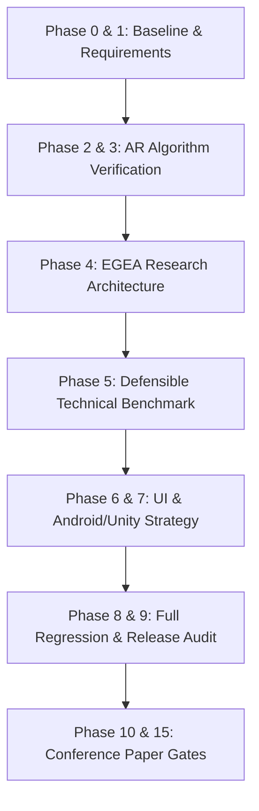

# AR-DSA Tutor — Conference-Grade Implementation & Verification Plan

**Version:** 1.0.0  
**Target:** Academic Conference & Production Release  
**Status:** In Execution  

---

## 1. Overview & Objectives

This implementation plan details the architectural, pedagogical, and software engineering tasks required to elevate AR-DSA Tutor to a conference-grade, reproducible research prototype.

The primary goals are:
1. **Flawless Multi-Algorithm Spatial AR Execution**: Ensure all 5 algorithms (BST, Bubble Sort, Binary Search, BFS, Stack) function within a single shared mobile WebXR session with zero resource leaks, upright camera alignment, and interactive HUD control.
2. **Execution-Grounded Explainable Adaptation (EGEA)**: Deliver a strongly-typed, deterministic research adaptation engine that observes spatial interaction events, maintains grounded learner state, and selects defensible pedagogical interventions with verifiable machine-readable rationales.
3. **Defensible Technical Benchmark**: Empirically evaluate EGEA against Generic Fixed Hint and Simple Error-Rule baselines across 7 distinct scenario families, providing micro-benchmarked latency, confusion matrices, and macro-F1 scores.
4. **Conference-Grade Engineering Rigor**: Enforce strict zero-fabrication rules, maintain 100% test pass rates across all suites, achieve zero linter warnings and clean distribution audits, and document cross-platform Android and Unity migration pathways.

---

## 2. Phase-by-Phase Work Breakdown

### Phase 0 & 1: Discovery Baseline & Acceptance Criteria
- [x] Verify Git baseline repository status (`5a648d7`)
- [x] Document environment, versions, and existing test metrics in `docs/FINAL_REVIEW_BASELINE.md`
- [x] Author comprehensive `docs/IMPLEMENTATION_PLAN.md`
- [ ] Author `docs/REQUIREMENTS_TRACEABILITY.md` covering all 25 core requirements

### Phase 2 & 3: Independent Verification of 5 AR Algorithms
- [x] Verify BST spatial tree construction, traversal, insertion, and search
- [x] Verify Bubble Sort comparisons, swaps, completed passes, and auto-play
- [x] Verify Binary Search range halving, target hit/miss, and auto-play
- [x] Verify BFS queue updates, neighbor visits, root vertex selector, and auto-play
- [x] Verify Stack LIFO ordering, push/pop animations, and 5-element overflow protection
- [ ] Author `docs/ALGORITHM_VERIFICATION.md` detailing mathematical state transitions and visual fidelity
- [ ] Author `docs/AR_SESSION_VERIFICATION.md` detailing WebXR lifecycle, surface detection, and memory cleanup

### Phase 4: Execution-Grounded Explainable Adaptation (EGEA) Implementation
- [ ] Create `src/services/research/egea/EGEAEventSchema.ts`: Strongly typed event interface and validator
- [ ] Create `src/services/research/egea/EGEAEventAdapter.ts`: Deterministic translator from raw engine steps to EGEA events
- [ ] Create `src/services/research/egea/EGEAPolicyEngine.ts`: Deterministic rule policy mapping learner state to 6 intervention classes
- [ ] Create `src/services/research/egea/EGEABaselines.ts`: Independent implementations of Baseline 1 (Fixed Hint) and Baseline 2 (Stateless Error Rule)
- [ ] Author research method documentation:
  - `docs/EGEA_METHOD.md`
  - `docs/EGEA_EVENT_SCHEMA.md`
  - `docs/INTERVENTION_TAXONOMY.md`
  - `docs/RESEARCH_LIMITATIONS.md`

### Phase 5: Defensible Technical Evaluation & Benchmarking
- [ ] Implement `src/services/research/egea/EGEAEvaluationHarness.ts`: Multi-scenario evaluation framework
- [ ] Implement `scripts/run_egea_benchmark.ts`: Standalone benchmark runner writing to `research-results/`
- [ ] Author `test/egeaEvaluationVerification.ts`: Comprehensive verification test suite
- [ ] Run benchmark and generate `research-results/egea_evaluation_report.json`
- [ ] Author `docs/RESEARCH_EVALUATION_PROTOCOL.md` and `docs/RESEARCH_EVALUATION_RESULTS.md`

### Phase 6 & 7: UI/UX, Android PWA & Unity Migration Specification
- [ ] Audit PWA manifest, service worker registration, and touch targets
- [ ] Author `docs/ANDROID_RELEASE_CHECKLIST.md` for mobile Chrome WebXR compliance
- [ ] Author `docs/UNITY_MIGRATION_SPEC.md` detailing architecture migration to Unity AR Foundation / ARCore

### Phase 8 & 9: Full Regression, Continuous Verification & Final Release Audit
- [ ] Wire `egeaEvaluationVerification.ts` into `scripts/run_all_tests.ts`
- [ ] Verify TypeScript types: `npx tsc -b` (0 errors)
- [ ] Verify linting: `npx oxlint` (0 errors)
- [ ] Execute all test suites: `npx tsx scripts/run_all_tests.ts` (16 suites, 100% pass)
- [ ] Execute production build: `npm run build`
- [ ] Execute security/distribution audit: `node scripts/audit_dist.js` (0 forbidden leaks)
- [ ] Author `docs/FINAL_ACCEPTANCE_REPORT.md`
- [ ] Author `docs/REPRODUCIBILITY.md`
- [ ] Author `docs/FINAL_DEMO_SCRIPT.md`

### Phase 10 & 15: Conference Paper Gates & Examiner Q&A
- [ ] Formulate defensible claims matrix distinguishing software-verified properties from future empirical human studies
- [ ] Detail academic architectural diagrams and data flows
- [ ] Compile comprehensive Examiner / Peer Reviewer Q&A
