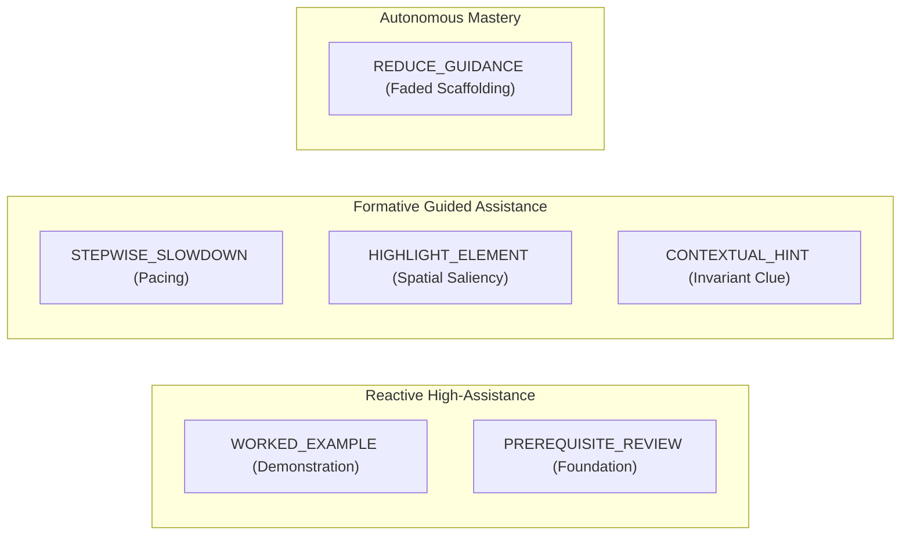

# Pedagogical Intervention Taxonomy for Spatial AR-DSA Learning

**Classification Framework:** Cognitive Load Theory & Scaffolding Fading Paradigm  
**Component Reference:** `src/services/research/egea/EGEAPolicyEngine.ts`  

---

## 1. Theoretical Grounding

According to Sweller's Cognitive Load Theory and the Zone of Proximal Development (Vygotsky), augmented reality visualizations introduce both germane spatial affordances and extraneous split-attention effects. 

The EGEA intervention taxonomy categorizes spatial interventions into six discrete tiers, dynamically balancing cognitive support against autonomous problem-solving:

---

## 2. Six Intervention Tiers

### 2.1 CONTEXTUAL_HINT
- **Pedagogical Objective:** Address an isolated conceptual misunderstanding without taking over control.
- **Trigger Condition:** A single incorrect action following correct execution or initial exploration.
- **Spatial Manifestation:** Subtle text overlay anchored near the relevant 3D node with a brief mathematical comparison rule (e.g., "$42 < 50$: Left subtree invariant applies").

### 2.2 HIGHLIGHT_ELEMENT
- **Pedagogical Objective:** Redirect visual attention when the learner exhibits spatial disorientation or misses an active node.
- **Trigger Condition:** `TRAVERSAL_DIRECTION` or `CYCLE_OR_UNVISITED` error.
- **Spatial Manifestation:** Emissive pulsing glow applied to the target 3D element (e.g., pulsing yellow bounding box around the active queue element or next valid graph vertex).

### 2.3 STEPWISE_SLOWDOWN
- **Pedagogical Objective:** Counteract impulsive "trial-and-error" rapid clicking / guessing.
- **Trigger Condition:** Consecutive errors executed with inter-action latency $\Delta t < 1500\text{ms}$.
- **Spatial Manifestation:** Interaction controls temporarily dimmed with a gentle 3-second reflection prompt: "Take a moment to inspect the data structure before your next move."

### 2.4 WORKED_EXAMPLE
- **Pedagogical Objective:** Overcome cognitive impasse and prevent learner helplessness after persistent failures.
- **Trigger Condition:** Three or more consecutive incorrect attempts on the exact same `stepIdentifier`.
- **Spatial Manifestation:** Automated 3D animated playback demonstrating the correct action on the spatial model, accompanied by a step-by-step explanatory voice/text prompt.

### 2.5 PREREQUISITE_REVIEW
- **Pedagogical Objective:** Remediate systemic conceptual deficiencies that prevent progress in the current algorithm.
- **Trigger Condition:** Cumulative error count $\ge 4$ with a failure rate exceeding 60% across multiple steps.
- **Spatial Manifestation:** High-level educational modal recommending navigation to the prerequisite curriculum topic (e.g., recommend "Binary Tree Basics" when struggling with BST traversal).

### 2.6 REDUCE_GUIDANCE
- **Pedagogical Objective:** Foster schema acquisition, germane cognitive processing, and independent retrieval practice.
- **Trigger Condition:** Mastery streak of $\ge 3$ consecutive correct decisions without accessing hints.
- **Spatial Manifestation:** Auxiliary pointer calipers, comparison labels, and guidance arrows gradually fade out, leaving the learner to execute decisions autonomously on the 3D model.

---

## 3. Measurable Educational Indicators

| Intervention | Intended Immediate Effect | Verification Metric |
|---|---|---|
| `STEPWISE_SLOWDOWN` | Increase subsequent action latency to $\ge 2500\text{ms}$ | Post-intervention $\Delta t$ distribution |
| `HIGHLIGHT_ELEMENT` | Eliminate orientation error on next move | Next action accuracy on highlighted node |
| `WORKED_EXAMPLE` | Enable student to solve subsequent similar step | Next step success rate without hint |
| `REDUCE_GUIDANCE` | Preserve accuracy while decreasing reliance on UI hints | Independent Success Rate ($ISR$) |
