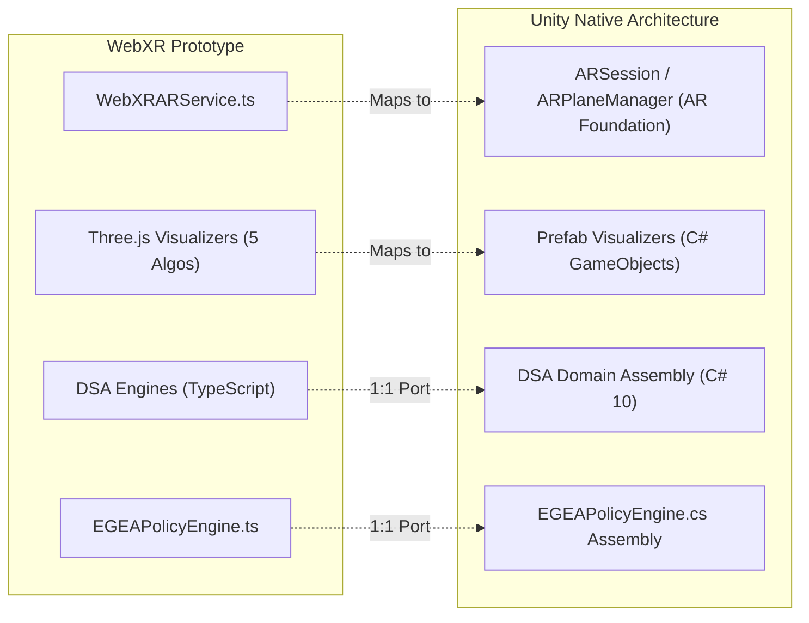

# AR-DSA Tutor — Unity AR Foundation Migration Specification

**Target Platform:** Unity 2023.2+ LTS / AR Foundation 5.1+  
**Target Runtimes:** Android (Google ARCore) & iOS (Apple ARKit)  
**Specification Reference:** UNITY-SPEC-2026-01  

---

## 1. Architectural Mapping

This document specifies the exact component translation from the current React + Three.js + WebXR architecture to a native Unity C# application utilizing AR Foundation.



---

## 2. Core Subsystem Translation Mapping

| WebXR Prototype (TypeScript / Three.js) | Unity Architecture (C# / AR Foundation) | Design Pattern & Implementation Notes |
|---|---|---|
| `WebXRARService.ts` | `ARSession` & `ARPlaneManager` | Handles device tracking, point cloud visualization, and camera passthrough. |
| `XRHitTestSource` raycasting | `ARRaycastManager.Raycast()` | Queries detected planes for surface hits (`TrackableType.PlaneWithinPolygon`). |
| `IARAlgorithmVisualizer.ts` | `IARAlgorithmVisualizer` (C# interface) | Methods: `Initialize(Transform anchor)`, `UpdateState(AlgorithmState state)`, `Reset()`, `Dispose()`. |
| `ThreeBSTVisualizer.ts` | `BSTSpatialPresenter.cs` + Prefab | Instantiates `TreeNodePrefab` with TextMeshPro 3D labels and LineRenderer for branches. |
| `ThreeBubbleSortVisualizer.ts` | `BubbleSortSpatialPresenter.cs` | Array elements as stylized cubes with DOTween for smooth quadratic swap arcs. |
| `ThreeBinarySearchVisualizer.ts` | `BinarySearchSpatialPresenter.cs` | Array row with animated bracket calipers (Low, Mid, High) and transparency shaders for eliminated halves. |
| `ThreeBFSVisualizer.ts` | `BFSSpatialPresenter.cs` | Graph nodes connected by line renderers with a 3D physical shelf for queue visualization. |
| `ThreeStackVisualizer.ts` | `StackSpatialPresenter.cs` | Transparent cylinder container mesh with tokens sliding vertically into position. |
| `EGEAPolicyEngine.ts` | `EGEAPolicyEngine.cs` | Pure C# static class with deterministic decision rules, $0\text{ms}$ allocations using `ReadOnlySpan<EGEAEvent>`. |
| React Learning HUD | Unity UI Toolkit (UI Elements) or Canvas | World-space or screen-space overlay with responsive scaling for mobile notches. |

---

## 3. C# Domain Engine Interfaces

### 3.1 Algorithm Visualizer Interface
```csharp
using UnityEngine;

namespace ARDSATutor.Core
{
    public interface IARAlgorithmVisualizer
    {
        string AlgorithmId { get; }
        void Mount(Transform spatialAnchor);
        void UpdateVisualState(DSAStateSnapshot state);
        void TriggerIntervention(EGEAInterventionDecision intervention);
        void ResetVisualization();
        void Teardown();
    }
}
```

### 3.2 EGEA Policy Invariant Port
```csharp
namespace ARDSATutor.Adaptation
{
    public enum EGEAInterventionType
    {
        ContextualHint,
        HighlightElement,
        StepwiseSlowdown,
        WorkedExample,
        PrerequisiteReview,
        ReduceGuidance
    }

    public static class EGEAPolicyEngine
    {
        public static EGEAInterventionDecision EvaluateIntervention(IReadOnlyList<EGEAInteractionEvent> history)
        {
            if (history == null || history.Count == 0)
            {
                return new EGEAInterventionDecision(EGEAInterventionType.ReduceGuidance, "NORMAL_PROGRESSION");
            }

            var last = history[^1];

            // 1. Mastery Streak
            if (IsMasteryStreak(history))
                return new EGEAInterventionDecision(EGEAInterventionType.ReduceGuidance, "INDEPENDENT_MASTERY_STREAK");

            if (last.IsCorrect)
                return new EGEAInterventionDecision(EGEAInterventionType.ReduceGuidance, "NORMAL_PROGRESSION");

            // 2. Impulsive Guessing
            if (IsRapidGuessing(history))
                return new EGEAInterventionDecision(EGEAInterventionType.StepwiseSlowdown, "RAPID_GUESSING_DETECTED");

            // 3. Persistent Failure (3+ times)
            if (IsPersistentStepFailure(history))
                return new EGEAInterventionDecision(EGEAInterventionType.WorkedExample, "PERSISTENT_STEP_FAILURE");

            // 4. Prerequisite Deficit
            if (IsPrerequisiteDeficit(history))
                return new EGEAInterventionDecision(EGEAInterventionType.PrerequisiteReview, "PREREQUISITE_DEFICIT");

            // 5. Spatial Attention Lapse
            if (last.ErrorCategory == EGEAErrorCategory.TraversalDirection || last.ErrorCategory == EGEAErrorCategory.CycleOrUnvisited)
                return new EGEAInterventionDecision(EGEAInterventionType.HighlightElement, "ATTENTION_SALIENCE_LAPSE");

            // 6. Isolated Conceptual Error
            return new EGEAInterventionDecision(EGEAInterventionType.ContextualHint, "ISOLATED_CONCEPTUAL_MISCONCEPTION");
        }
    }
}
```

---

## 4. Build & Distribution Pipelines
1. **Android (Google Play):** Unity Gradle build targeting Android API level 34, ARM64 architecture, Vulkan/OpenGLES3 graphics, with ARCore Optional/Required manifest metadata.
2. **iOS (App Store):** Xcode project targeting iOS 16.0+, Metal graphics, with `NSCameraUsageDescription` configured.
