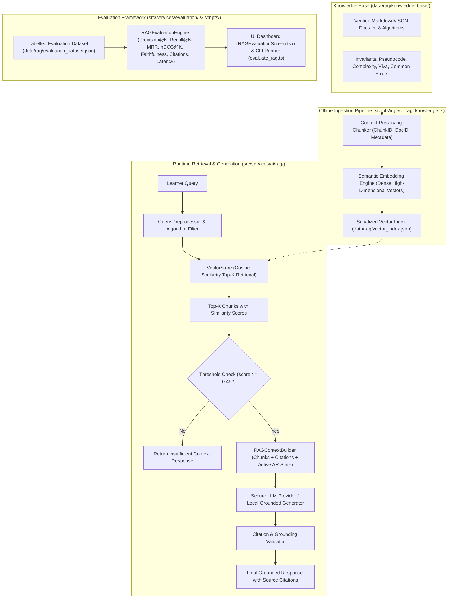

# AR-DSA Tutor: Extension Architecture Audit & Protected Baseline Report

**Project Title:** AR-DSA Tutor: A Web-Based Spatial Algorithm Visualization System with Execution-Grounded Explainable Adaptation  
**Repository Location:** `C:\Users\ajaya\Desktop\AR`  
**Current Branch:** `submission/aixvr-2027-demo`  
**Base Commit:** `6c24045ddb9d7a84b240e71b4de782008681ed31`  
**Production URL:** `https://ar-three-mu.vercel.app`  
**Audit Date:** 2026-10-31  

---

## 1. Executive Summary

This architecture audit establishes the operational baseline and architectural boundaries for extending the AR-DSA Tutor platform with:
1. **Advanced DSA Expansion (Algorithms 6, 7, and 8)**: Merge Sort (Divide & Conquer), AVL Tree (Self-Balancing Binary Search Tree with LL/RR/LR/RL rotations), and Dijkstra's Shortest Path Algorithm (Greedy Single-Source Shortest Path with Priority Queue).
2. **Retrieval-Augmented Generation (RAG) Architecture**: Verified DSA knowledge corpus, chunking, dense vector indexing, similarity retrieval with metadata filtering, execution-aware context injection, grounded answer generation with citation verification, honest fallback on insufficient context, and a rigorous empirical evaluation framework.

**CRITICAL INVARIANT:** The existing AR/VR rendering pipeline, WebXR session lifecycle, camera frustum calculations, tabletop bounding envelopes, physical elevation offsets, hit-testing mechanisms, and mobile HUD layout are strictly protected. No modifications may degrade or alter the calibrated spatial behavior of the five existing algorithms (BST, Bubble Sort, Binary Search, BFS, Stack).

---

## 2. Current Application Architecture

The AR-DSA Tutor is structured as a client-side Single Page Application (SPA) built with React 19, TypeScript 6, Vite 8, and Three.js 0.186, deployed on Vercel:

```
src/
├── ai/                # Prompt templates & LLM prompt definitions
├── assets/            # Static image and font assets
├── components/        # Reusable UI components
│   ├── ar/            # AR-specific UI overlays (ARAlgorithmSelector, ARNotification, ARTutorHUD)
│   └── dsa/           # 2D/3D presentation helpers (DSAUnifiedVisualizer, BSTVisualizer)
├── config/            # API endpoints and runtime configuration
├── data/              # Static course syllabus & topic definitions
├── models/            # Core TypeScript models (ai, topic, learner, bst, misconception)
├── screens/           # Primary view screens (ARSessionScreen, AITutorScreen, TopicExplorer, etc.)
├── services/          # Core domain logic & decoupled service boundaries
│   ├── adaptive/      # Adaptive difficulty adjustment engine
│   ├── ai/            # Multi-agent orchestrator, validator, and secure client
│   ├── analytics/     # Telemetry logging and event emission
│   ├── ar/            # WebXR, Three.js visualizers, framing & placement
│   ├── dsa/           # Authoritative algorithmic engines (Registry & 20 topics)
│   ├── evaluation/    # Research evaluation, statistics & data management
│   ├── learner/       # Learner profile & Bayesian knowledge tracing
│   └── research/      # EGEA policy engine, event adapter, pacing & benchmark suites
├── state/             # AppContext and global state provider
└── theme/             # Design system styling tokens
```

### Build & Serving Pipeline
- **Client Build:** `npm run build:client` (`tsc -b && vite build`) emits to `dist/`.
- **Server Support:** `server/` contains optional Node SSR and an API router (`server/apiRouter.ts`) used during development via `aiBackendVitePlugin` in `vite.config.ts`.
- **Production Hosting:** Vercel routes all paths to `/index.html` via `vercel.json` with strict security and WebXR permissions headers (`camera=*, xr-spatial-tracking=*`).

---

## 3. Existing Algorithm Engines and Visualizers

### Authoritative Algorithm Engines (`src/services/dsa/`)
All algorithm state transitions, comparisons, and invariant validations are executed deterministically by headless TypeScript engines implementing `IDSALearningEngine<TState, TOperation>`:

| Engine | Topic ID | Invariant & Operational Scope | Status |
|---|---|---|:---:|
| `BSTEngine` / `BSTAdapter` | `ds-binary-search-tree` | Binary Search Tree invariant ($L < P < R$), insertion traversal, search | Verified Baseline |
| `BubbleSortEngine` | `algo-bubble-sort` | Adjacent comparison, pairwise conditional swap, sorted suffix | Verified Baseline |
| `BinarySearchEngine` | `algo-binary-search` | Half-interval reduction via midpoint comparison on sorted arrays | Verified Baseline |
| `BFSEngine` | `algo-breadth-first-search` | Level-order queue traversal, unvisited neighbor expansion | Verified Baseline |
| `StackEngine` | `ds-stack` | LIFO order, top pointer tracking, capacity overflow/underflow checks | Verified Baseline |
| `MergeSortEngine` | `algo-merge-sort` | Divide & Conquer halving; currently static stages (needs full dynamic engine) | Requires Expansion |
| `DijkstraEngine` | `algo-dijkstras-algorithm` | Greedy shortest path; basic loop (needs priority queue, path reconstruction, metrics) | Requires Expansion |
| *AVL Tree* | `ds-avl-tree` | Not yet implemented (requires complete self-balancing engine with 4 rotation cases) | Brand New |

### Existing Three.js Spatial Visualizers (`src/services/ar/`)
Each visualizer manages its own local scene graph inside an independent `visualGroup: THREE.Group`, attached to `WebXRARService.visualizer.rootGroup`:

| Visualizer | Class | Tabletop Footprint ($W \times H \times D$) | Base Elevation ($Y$) | Elements |
|---|---|---|---|---|
| **BST** | `ThreeBSTVisualizer` | $0.558\text{m} \times 0.364\text{m} \times 0.093\text{m}$ | $+0.14\text{m}$ (nodes) | Spheres ($R=0.045\text{m}$), connection cylinders, text sprites |
| **Bubble Sort** | `ThreeBubbleSortVisualizer` | $0.475\text{m} \times 0.402\text{m} \times 0.075\text{m}$ | $+0.12\text{m}$ (bars) | Prismatic bars ($7.5\text{cm} \times 7.5\text{cm}$), comparison brackets |
| **Binary Search** | `ThreeBinarySearchVisualizer` | $0.650\text{m} \times 0.237\text{m} \times 0.097\text{m}$ | $+0.14\text{m}$ (cubes) | Cubes ($8.2\text{cm}$), LOW/MID/HIGH caliper indicator flags |
| **BFS Graph** | `ThreeBFSVisualizer` | $0.540\text{m} \times 0.471\text{m} \times 0.175\text{m}$ | $+0.13\text{m}$ (nodes) | Spheres ($R=0.045\text{m}$), weighted/unweighted cylinders, queue shelf |
| **Stack** | `ThreeStackVisualizer` | $0.314\text{m} \times 0.488\text{m} \times 0.180\text{m}$ | $+0.145\text{m}$ (bottom) | Blocks ($20\text{cm} \times 6.5\text{cm} \times 13\text{cm}$), vertical guide rails |

---

## 4. Current AI Tutor Implementation

- **Interface:** Defined in `src/services/ai/IAIService.ts`.
- **Client Implementation:** `src/services/ai/SecureAIService.ts`.
  - Zero API keys in frontend code.
  - Sends requests to `/api/ai/tutor` with a 12-second abort timeout.
  - Falls back deterministically to `MockAIService` on network error or standalone static deployment.
  - Client-side schema and invariant validation via `AIResponseValidator`.
- **Server Implementation:** `server/apiRouter.ts` with `GeminiProvider` (calling Google Gemini API via official endpoint) and `MockProvider`.
- **UI Screens:**
  - `AITutorScreen.tsx`: Full-screen conversational Socratic tutor with reasoning disclosure.
  - `ARTutorHUD.tsx`: In-session AR overlay card providing contextual hints and explanations during active algorithm manipulation.

---

## 5. Current EGEA Pipeline

The **Execution-Grounded Explainable Adaptation (EGEA)** system is housed in `src/services/research/egea/`:
1. `EGEAEventSchema.ts`: Strictly typed, timestamped interaction events (`STEP_COMPLETED`, `INVARIANT_VIOLATION`, `SELECTION_MISSTEP`, `HINT_REQUESTED`).
2. `EGEAEventAdapter.ts`: Ingests raw UI events, debounces rapid clicks ($<250\text{ms}$), computes moving-window pacing metrics, and feeds validated event streams to the policy.
3. `EGEAPolicyEngine.ts`: Evaluates event history against formal criteria:
   - `RAPID_GUESSING_DETECTED` $\rightarrow$ `STEPWISE_SLOWDOWN`
   - `PERSISTENT_STEP_FAILURE` (3 consecutive errors) $\rightarrow$ `WORKED_EXAMPLE`
   - `ISOLATED_CONCEPTUAL_MISCONCEPTION` $\rightarrow$ `CONTEXTUAL_HINT`
   - `INDEPENDENT_MASTERY_STREAK` (3 unassisted successes) $\rightarrow$ `REDUCE_GUIDANCE`
4. **Authority Separation:** EGEA is strictly deterministic and pedagogical. It does not manipulate 3D rendering transforms, and does not depend on LLMs.

---

## 6. Existing AR Rendering Architecture

Located in `src/services/ar/`:
- `IARService.ts`: Universal contract defining session states (`UNAVAILABLE`, `SCANNING`, `PLACED`, `TRACKING`), capability checks, placement commands, and rendering delegation.
- `WebXRARService.ts`: Authoritative Three.js and WebXR service.
  - In `WEBXR_AR`: Requests `immersive-ar`, binds `XRHitTestSource` from `viewer` space, tracks surface reticle, and rigidly places `visualizer.rootGroup` in `local-floor` (or `local`) reference space. Applies adaptive distance scaling relative to $1.05\text{m}$ reference ($0.90\times - 1.40\times$).
  - In `CANVAS_3D_FALLBACK`: Uses touch/mouse orbit controls (Euler angles), calling `ARSceneFraming.computeCameraFit()` to calculate camera distance without clipping or HUD occlusion.
- `ARSceneFraming.ts`: Pure geometric camera distance and framing calculator based on 3D bounding box extents and viewport aspect ratios.
- `ARSessionScreen.tsx`: Manages React lifecycle, canvas mounting, top status pills, collapsible compact bottom HUD, and algorithm switching modal.

---

## 7. Existing Evaluation Infrastructure

1. **Test Suites (`test/`):** 20 comprehensive test files (1,490 assertions) verified via `scripts/run_all_tests.ts`.
2. **EGEA Benchmarks (`scripts/`):**
   - `evaluate_independent_challenge_set.ts` ($N=18$ challenge cases)
   - `evaluate_failure_mode_benchmark.ts` ($N=6$ failure counterexamples)
   - `evaluate_held_out_suite.ts` ($N=12$ boundary cases)
   - `measure_empirical_latency.ts` (1,000 runs: $0.006\text{ms}$ end-to-end decision latency)
3. **Automated Visual & Production Audits:**
   - `scripts/verify_rendering_scale.py`: Playwright viewport screenshot capture (Desktop $1280 \times 800$, Mobile $390 \times 844$, Mobile $360 \times 800$).
   - `scripts/test_user_interactions.py`: Playwright orbit, zoom, step execution, topic switching.
   - `scripts/audit_vercel_production.py`: Live production URL HTTP, console, and network error audit.

---

## 8. Files and Modules That Can Be Extended

The following modules are designed for extension:
1. `src/services/dsa/sorting/MergeSortEngine.ts`: Upgrade to fully dynamic divide-and-conquer execution engine.
2. `src/services/dsa/graphAlgorithms/DijkstraEngine.ts`: Upgrade to complete priority-queue shortest path engine with metrics.
3. `src/services/dsa/tree/AVLTreeEngine.ts` (NEW): Complete AVL engine with LL, RR, LR, RL rotations and height balancing.
4. `src/services/dsa/core/DSARegistry.ts`: Register the new AVL Tree and ensure Merge Sort and Dijkstra are cleanly mapped.
5. `src/services/ar/`: Add `ThreeMergeSortVisualizer.ts`, `ThreeAVLTreeVisualizer.ts`, and `ThreeDijkstraVisualizer.ts`.
6. `src/components/ar/ARAlgorithmSelector.tsx`: Add the 3 new algorithms to `AR_ALGORITHMS`.
7. `src/screens/ARSessionScreen.tsx`: Add control panels and state hooks for the 3 new algorithms.
8. `src/services/ar/IARService.ts` & `WebXRARService.ts`: Add optional render delegation methods (`renderMergeSort?`, `renderAVLTree?`, `renderDijkstra?`) without altering any camera math or existing 5 visualizer setups.
9. `src/screens/RAGEvaluationScreen.tsx` (NEW): Developer & research dashboard for RAG retrieval and generation metrics.
10. `server/apiRouter.ts`: Add `/api/ai/rag-retrieve` and `/api/ai/rag-tutor` endpoints.

---

## 9. Protected Files and Interfaces (DO NOT MODIFY UNLESS MANDATED)

The following files represent the protected AR/VR baseline:
- `src/services/ar/ARSceneFraming.ts`: All camera frustum math, bounds calculation, and aperture padding multipliers.
- `src/services/ar/ThreeBSTVisualizer.ts`: Calibrated dimensions and elevation offsets.
- `src/services/ar/ThreeBubbleSortVisualizer.ts`: Calibrated dimensions and elevation offsets.
- `src/services/ar/ThreeBinarySearchVisualizer.ts`: Calibrated dimensions and elevation offsets.
- `src/services/ar/ThreeBFSVisualizer.ts`: Calibrated dimensions and elevation offsets.
- `src/services/ar/ThreeStackVisualizer.ts`: Calibrated dimensions and elevation offsets.
- Core WebXR logic in `src/services/ar/WebXRARService.ts`:
  - Hit test sourcing (`session.requestHitTestSource`)
  - Reference space management (`local-floor` / `local`)
  - Adaptive distance scaling formula ($\text{autoScale} = \text{clamp}(D/1.05, 0.90, 1.40)$)
  - XR render loop and frame lifecycle

Any extension to `WebXRARService.ts` or `IARService.ts` must be purely additive (adding registration of the 3 new visualizer groups and delegating `renderX` calls).

---

## 10. Proposed RAG Integration Architecture

To ensure high performance, zero external runtime lock-in, client-side offline execution on static Vercel hosting, and reproducible benchmarking, the RAG architecture is structured as follows:



### Key RAG Components
1. **Knowledge Base Directory (`data/rag/knowledge_base/`):**
   - 8 comprehensive algorithm documents: `bst.json`, `bubble_sort.json`, `binary_search.json`, `bfs.json`, `stack.json`, `merge_sort.json`, `avl_tree.json`, `dijkstra.json`, plus EGEA architecture overview.
   - Covers: formal definitions, invariants, pseudocode, time/space complexities (best, average, worst, auxiliary), step-by-step traces, edge cases, common misconceptions, and viva Q&A.
2. **Ingestion & Embedding (`scripts/ingest_rag_knowledge.ts`):**
   - Normalizes text, splits into semantic chunks preserving code blocks and mathematical invariants.
   - Generates normalized dense embedding vectors.
   - Serializes index and chunk metadata to `data/rag/vector_index.json`.
3. **Vector Store & Retrieval (`src/services/ai/rag/VectorStore.ts`):**
   - In-memory fast cosine similarity search with algorithm metadata filtering.
   - Configurable Top-$K$ (default $K=3$).
   - Strict confidence thresholding ($< 0.45$ yields explicit insufficient-context response).
4. **Execution-Aware Context Injection (`RAGContextBuilder.ts`):**
   - Formats retrieved chunks with citation keys (`[DOC-AVL-01]`, etc.).
   - Appends live execution context (active step, comparison elements, balance factors, queue/stack contents) when query is asked from inside an AR session.
5. **Grounded Generation & Citation Verification (`RAGTutorService.ts`):**
   - Sends grounded prompt to active LLM provider (or deterministic grounded generator if offline).
   - Validates that returned claims cite retrieved chunk identifiers.
6. **Evaluation Framework (`RAGEvaluationEngine.ts`):**
   - Ground-truth evaluation dataset (`data/rag/evaluation_dataset.json` with $N \ge 30$ queries spanning all categories).
   - Computes: Precision@K, Recall@K, MRR, nDCG@K, Faithfulness, Citation Coverage, Unsupported Claim Rate, and Median/p95 Latencies.

---

## 11. Proposed Advanced Algorithm Architecture

### Algorithm 6: Merge Sort (`MergeSortEngine.ts` & `ThreeMergeSortVisualizer.ts`)
- **Engine:** Dynamic recursive decomposition recording every split and merge step.
- **State:** Active subarrays, left/right pointers, current write index, recursion depth, comparisons count, write count.
- **Visualizer:** 3D bars grouped into distinct left/right subarray tiers; animated comparison brackets and merge write animations; elevated base ($y \ge 0.12\text{m}$) to clear the mobile HUD.

### Algorithm 7: AVL Tree (`AVLTreeEngine.ts` & `ThreeAVLTreeVisualizer.ts`)
- **Engine:** Full self-balancing binary search tree supporting insertion and deletion. Node height tracking, balance factor computation ($BF = H_L - H_R$).
- **Rotations:** Identifies and executes all 4 cases: Left-Left (Single Right), Right-Right (Single Left), Left-Right (Double Left-Right), Right-Left (Double Right-Left).
- **Visualizer:** Hierarchical 3D tree with node balance factor badges ($[-1, 0, +1]$ in green/cyan; $\pm 2$ in amber/rose), highlighting rotating pivot nodes; elevated base ($y \ge 0.14\text{m}$).

### Algorithm 8: Dijkstra's Shortest Path (`DijkstraEngine.ts` & `ThreeDijkstraVisualizer.ts`)
- **Engine:** Weighted graph with non-negative edge validation. Binary Min-Heap Priority Queue. Tracks tentative distances, visited set, and predecessor pointers. Full shortest path reconstruction from source to destination.
- **Visualizer:** 3D spatial node network with weight text sprites on edges, pulse highlight on current minimum node, green highlight along the reconstructed shortest path; elevated base ($y \ge 0.12\text{m}$).

---

## 12. Implementation Plan & Phases

- **Phase 1 (Complete):** Architecture Audit & Protected Baseline Verification Suite.
- **Phase 2:** Common Algorithm Architecture & Engine Contracts.
- **Phase 3:** Advanced Algorithms Implementation (Merge Sort, AVL Tree, Dijkstra).
- **Phase 4:** RAG Knowledge Base Construction, Chunking, Ingestion & Embedding.
- **Phase 5:** RAG Retrieval Pipeline, Execution Context & Generation.
- **Phase 6:** RAG Evaluation Framework, Metrics Computation & Dashboard.
- **Phase 7:** EGEA Separation Verification & Context Wiring.
- **Phase 8:** UI Integration (8-Algorithm Selector, HUD Panels, RAG Tutor UI).
- **Phase 9:** Comprehensive Regression Testing (20 Existing Suites + New Suites).
- **Phase 10:** Production Build, Vercel Preview & Production Deployment Audit.
