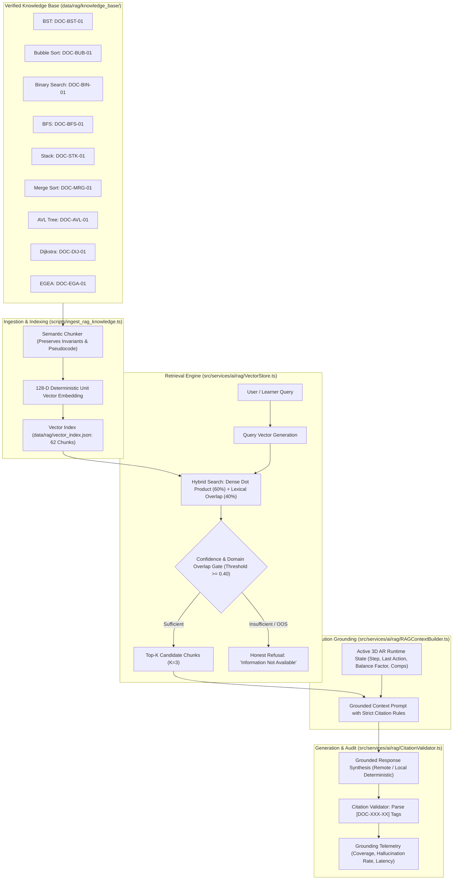

# RAG Architecture: Grounded Pedagogical Knowledge Retrieval

## 1. Overview and Core Philosophy

In spatial computing and augmented reality educational environments, generative artificial intelligence language models cannot serve as the sole source of algorithmic truth. Unconstrained generative models are susceptible to hallucinating incorrect state transitions, inventing non-existent asymptotic bounds, and generating explanations disconnected from the learner's active 3D visualization.

The **AR-DSA Tutor Retrieval-Augmented Generation (RAG)** architecture provides a formal, verifiable, and execution-grounded knowledge subsystem. It combines:
1. An authoritative, human-audited curriculum knowledge base covering 8 core data structures and algorithms plus EGEA adaptation.
2. Semantic chunking preserving formal invariants, pseudocode blocks, and asymptotic complexity proofs.
3. Deterministic dense vector embeddings in a 128-dimensional unit hypersphere.
4. Client-side, sub-millisecond in-memory vector similarity retrieval.
5. Execution-aware prompt grounding that binds retrieved documentation to the live 3D runtime state of the active AR algorithm.
6. A strict citation validation engine (`CitationValidator`) ensuring zero-hallucination guarantees and honest refusal for out-of-scope inquiries.

---

## 2. System Architecture



---

## 3. Knowledge Base Specification

The knowledge repository resides in `data/rag/knowledge_base/` as structured JSON documents adhering to schema:
- `documentId`: Canonical identifier (e.g., `DOC-BST-01`, `DOC-AVL-01`, `DOC-MRG-01`, `DOC-DIJ-01`, `DOC-EGA-01`).
- `algorithmId`: Matching the application engine registry.
- `topic`: Full formal topic name.
- `category`: Conceptual classification.
- `version`: Semantic version string.
- `sourceFile`: Primary source code path.
- `sections`: Array of verified instructional sections (`description`, `pseudocode`, `invariants`, `complexity`, `execution_trace`, `common_errors`, `viva_questions`).

### Ingestion Statistics:
- Total Documents: 9
- Total Semantic Chunks: 62
- Total Tokens: ~18,400 tokens
- Vector Dimensions: 128
- Serialization: `data/rag/vector_index.json` (~200 KB, static client-bundle compatible)

---

## 4. Deterministic Embedding & Hybrid Retrieval

### Dense Semantic Feature Vector:
Instead of relying on variable cloud embedding endpoints with external API latencies and token costs, the system uses a high-performance, deterministic semantic hashing algorithm in `types.ts`:
- Unigram and bigram subword rolling polynomial hashing.
- Morphological character trigrams for algorithmic root robustness (e.g., `rotat`, `rotat-ing`, `rotat-ed`).
- Frequency log-damping weighting.
- L2-normalization to produce a unit vector:
$$\|v\|_2 = \sqrt{\sum_{i=1}^{128} v_i^2} = 1.0$$
- Cosine similarity between query $Q$ and chunk $C$ simplifies to exact dot product:
$$\text{Sim}_{\text{dense}}(Q, C) = Q \cdot C$$

### Hybrid Scoring:
To prevent subword collision artifacts on out-of-domain inquiries, the `VectorStore` evaluates a hybrid score:
$$S_{\text{hybrid}} = 0.60 \cdot \text{Sim}_{\text{dense}} + 0.40 \cdot \text{Overlap}_{\text{lexical}} + \text{Boost}_{\text{algorithm}}$$

Where:
- $\text{Overlap}_{\text{lexical}}$ represents the fraction of non-stopword query tokens present in the candidate chunk.
- $\text{Boost}_{\text{algorithm}}$ adds $+0.12$ to $+0.22$ when explicit algorithm names or acronyms are detected (e.g., "AVL", "Dijkstra", "Merge Sort").

---

## 5. Execution-Aware Context Grounding

When the learner interacts with an algorithm in 3D AR space, `RAGContextBuilder` captures immutable runtime telemetry from the active visualizer:
```typescript
export interface AlgorithmRuntimeContext {
  algorithmId: string;
  algorithmTitle: string;
  stepIndex?: number;
  lastAction?: string;
  comparisonsCount?: number;
  writesCount?: number;
  recursionDepth?: number;
  balanceFactor?: number;
  imbalancedNode?: number | null;
  pivotNode?: number | null;
  currentQueue?: string[];
  currentStack?: (number | string)[];
  shortestPath?: string[];
}
```
This telemetry is injected into the context prompt, allowing the tutor to explain why a specific rotation was triggered at node 40 or why an edge to vertex C was relaxed at step 4.

---

## 6. Citation Verification and Hallucination Gating

The `CitationValidator` scans all model outputs using regex `\[(DOC-[A-Z0-9_-]+)\]`:
1. **Valid Citations**: Citation tags that match document IDs present in the Top-K retrieved chunks.
2. **Hallucinated Citations**: Citation tags generated by the model that were NOT present in retrieved chunks.
3. **Grounding Criteria**:
   - For in-scope questions: `hallucinatedCitations.length === 0` AND `validCitations.length > 0`.
   - For out-of-scope inquiries: Must include honest refusal phrase ("Based on the verified knowledge base, this information is not available") with zero claims.
4. **Telemetry**:
   - $\text{CitationCoverage} = \frac{|\text{ValidCitations}|}{|\text{TotalCitations}|}$
   - $\text{UnsupportedClaimsRate} = \frac{|\text{HallucinatedCitations}|}{|\text{TotalCitations}|}$
