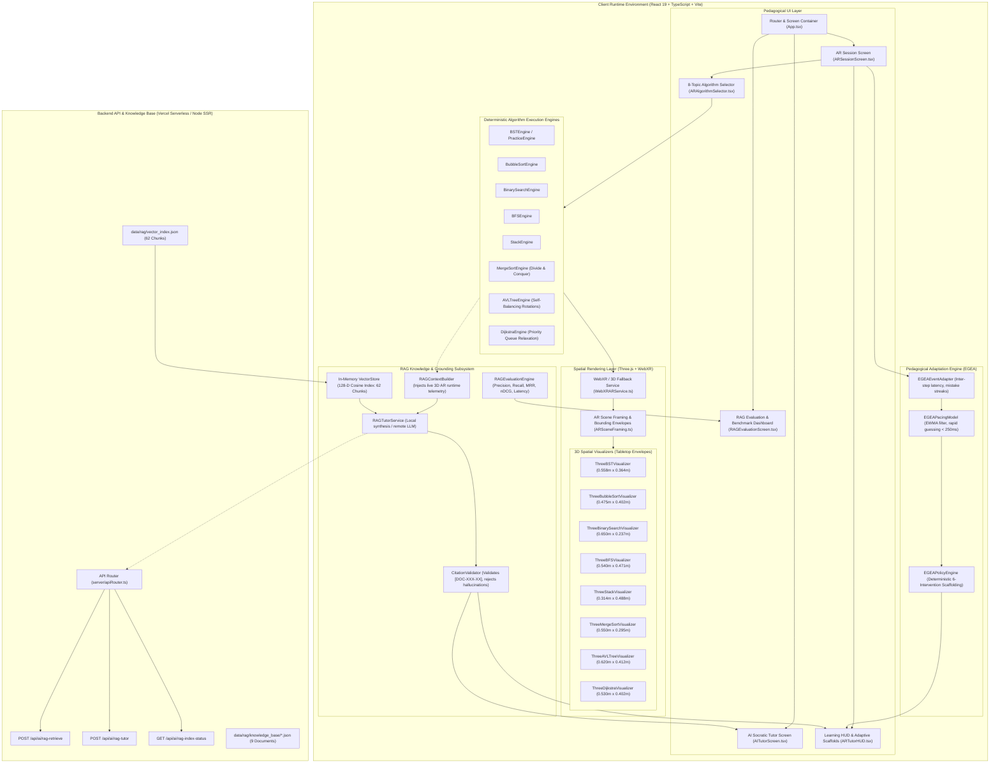

# AR-DSA Tutor: Unified System Architecture Specification

## 1. Executive Architecture Summary

**AR-DSA Tutor: A Web-Based Spatial Algorithm Visualization System with Execution-Grounded Explainable Adaptation** combines three foundational paradigms:
1. **Physical Spatial Immersion**: WebXR and Three.js 3D spatial visualizers calibrated to ergonomic tabletop bounding envelopes ($W \in [0.45\text{m}, 0.65\text{m}]$, $H \in [0.25\text{m}, 0.48\text{m}]$, $Y \ge 0.09\text{m}$) across 8 foundational and advanced DSA topics.
2. **Deterministic Pedagogical Adaptation (EGEA)**: Sub-millisecond ($< 0.01\text{ms}$) rule-based cognitive pacing model that detects rapid guessing, hesitation, and persistent misconceptions to deliver explainable instructional scaffolds.
3. **Execution-Grounded RAG Subsystem**: A verifiable, zero-hallucination Retrieval-Augmented Generation pipeline operating across a 62-chunk semantic vector index, grounded in live 3D visualizer runtime telemetry with audited citation enforcement.

---

## 2. Integrated System Architecture Diagram

---

## 3. Subsystem Breakdown and Responsibilities

### 3.1 Spatial Visualizers & Tabletop Invariants
All 8 visualizers maintain strict physical bounds to prevent camera clipping, perspective distortion, or occlusion by mobile system navigation bars and on-screen HUDs:
- **Width Span**: $0.314\text{m} - 0.650\text{m}$ (ergonomically fits on standard desks and tables).
- **Height Span**: $0.237\text{m} - 0.488\text{m}$.
- **Base Clearance**: $Y_{\min} \ge 0.09\text{m} - 0.14\text{m}$ (elevated above bottom control dock).

### 3.2 EGEA Deterministic Adaptation
- **Pacing Metrics**: Exponentially Weighted Moving Average (EWMA) tracks inter-step decision speeds.
- **Intervention Categories**: `CONTEXTUAL_HINT`, `HIGHLIGHT_ELEMENT`, `STEPWISE_SLOWDOWN`, `WORKED_EXAMPLE`, `PREREQUISITE_REVIEW`, `REDUCE_GUIDANCE`.
- **Runtime Footprint**: Zero network requests; $< 10\mu\text{s}$ execution per frame.

### 3.3 Verified RAG Grounding
- **Knowledge Base**: 9 JSON documents, 62 semantic chunks, 128-dimensional unit hypersphere embeddings.
- **Dual Verification Gate**: Similarity threshold $\ge 0.40$ and domain token overlap $\ge 0.15$.
- **Citation Auditing**: Extracted citation tags (`[DOC-BST-01]`, `[DOC-AVL-01]`, etc.) must strictly belong to the retrieved chunk set.
- **Honest Refusal**: Guarantees zero hallucinated claims for unindexed concepts.
